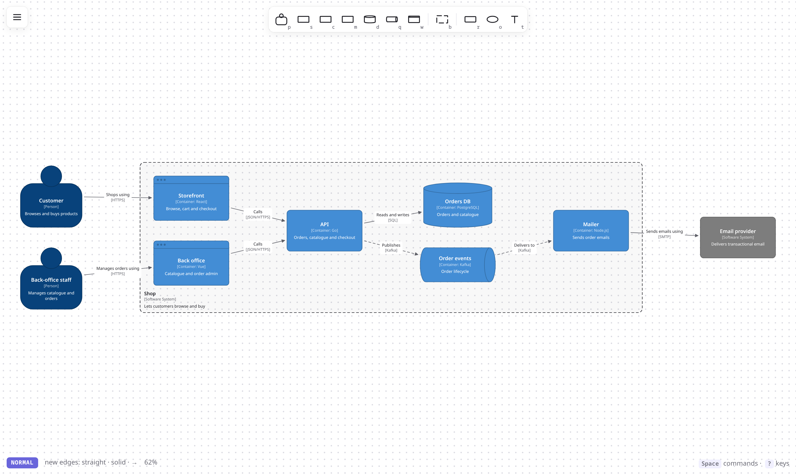
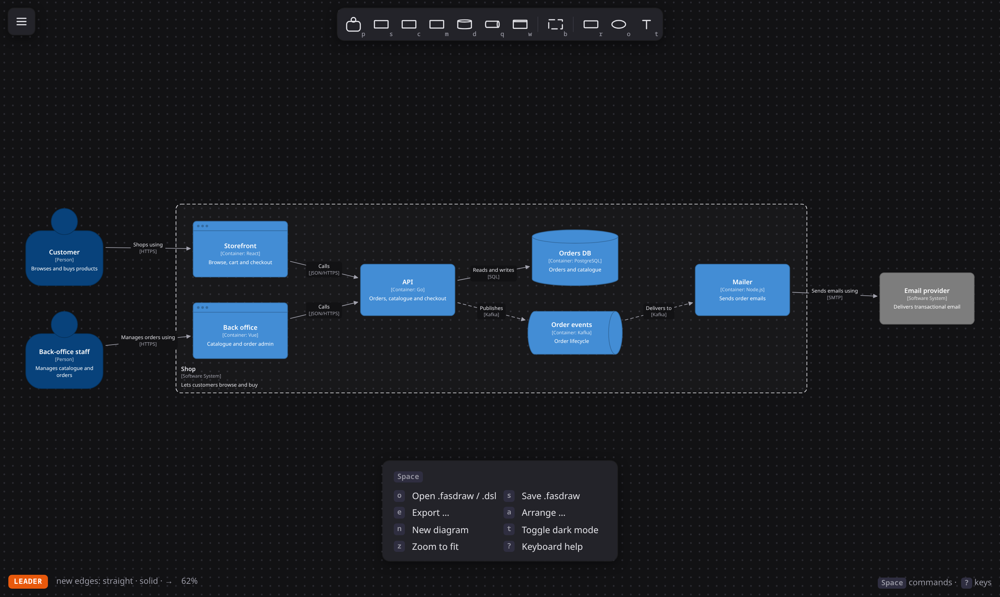

<div align="center">

<picture>
  <source media="(prefers-color-scheme: dark)" srcset="brand/logo-dark.svg">
  
</picture>

**Architecture diagrams at the speed you think.**

Keyboard-first C4 diagramming with an Excalidraw-clean canvas: shapes, lines, colors and labels are
one keystroke away, the way switching from an IDE to Vim feels.

[](LICENSE)




</div>

## Why

Draw.io and Excalidraw are great, but getting an idea from your head onto the board still means
hunting through palettes and dragging handles. fasdraw is built around three ideas:

- **C4 conventions, not UML ceremony.** Person, system, container, component, database, queue,
  web app and boundary are first-class shapes with C4 colors and `[Container: tech]` captions.
- **Modal, keyboard-first editing.** Drop a shape at the cursor with one key, grow a connected node
  with `Tab`, flip a line to dashed with `-`. Every action is also clickable, and the UI shows the key.
- **Diagrams as code when you want it.** Paste [Structurizr DSL](https://docs.structurizr.com/dsl),
  the open C4 language, and get a laid-out diagram; export it back for your repo.

## Quick start

```sh
git clone https://github.com/osrcmap/fasdraw && cd fasdraw
npm install
npm run dev        # http://localhost:5173
```

```sh
npm test           # node's built-in test runner (Node ≥ 22.18)
npm run build      # static site in dist/ — host it anywhere
```

## Drawing from your head

Hover the canvas and type. Typing `p` *Customer* `Tab` *Web App [React]* `Tab` *API [Go]*
`Esc` gives you three connected boxes without touching the mouse.

| Keys | Action |
| --- | --- |
| `p` `s` `c` `m` `d` `q` `w` | person · system · container · component · database · queue · web app. Drops at the cursor, or **converts** the selection |
| `b` | boundary. With nodes selected, it wraps them |
| `r` `o` `t` | rectangle · ellipse · text |
| `H` `J` `K` `L` · `Tab` | grow a new connected node ← ↓ ↑ →. `Tab` repeats the last direction, even while typing |
| `h` `j` `k` `l` | jump to the nearest node in that direction |
| `1`–`9` · `0` | color · back to the C4 default |
| `-` · `e` · `a` | solid/dashed/dotted · straight/elbow/curved · arrowheads. The last style sticks for new lines |
| `x` | mark as external (C4 gray) |
| `>` | connect the selected nodes in the order you picked them |
| `i` / `Enter` · `I` | edit label · label the incoming relationship |
| `Space` | command menu: open, save, export, align, distribute, theme (hold and drag to pan) |
| `?` | every shortcut |

**Labels have a tiny grammar.** `API [Go]` sets name and technology, `Shift+Enter` adds a
description line, and the C4 caption is rendered for you.



## Diagrams as code: Structurizr DSL

fasdraw reads and writes [Structurizr DSL](https://docs.structurizr.com/dsl) instead of
inventing a new format, so your models work with the rest of the C4 tooling.

```text
workspace {
    model {
        customer = person "Customer"
        shop = softwareSystem "Shop" {
            api = container "API" "Orders and checkout" "Go"
            db = container "Orders DB" "" "PostgreSQL" "Database"
        }
        customer -> api "Buys using" "HTTPS"
        api -> db "Reads and writes" "SQL"
    }
}
```

- **Import:** paste it on the canvas, drop a `.dsl` file, or `Space o`. Elements, nesting
  (systems → containers → components, groups), tags, `shape`/`background` styles,
  relationship `style`/`routing` and `autolayout` direction are understood. The model is laid out
  automatically.
- **Export:** `Space e t` writes a valid workspace with views and C4 styles. Layout is not part of
  the DSL, so keep `.fasdraw` as the lossless format.

A complete example lives in [`examples/shop.dsl`](examples/shop.dsl). It is the diagram in the
screenshot above.

## Files

| Format | |
| --- | --- |
| `.fasdraw` | native, lossless JSON (`{ type, version, nodes, edges }`), diff-friendly. Open with `Ctrl+O`, drag-and-drop or paste. Work is also autosaved in the browser |
| `.dsl` | Structurizr DSL import and export |
| `.excalidraw` | export with native shapes, bound labels and bound arrows |
| SVG · PNG · PDF | export (`Space e s` / `p` / `d`) |

## How it's built

No framework and no runtime dependencies. TypeScript draws straight to a `<canvas>`, with Vite to
build. One pure display list feeds the canvas, SVG and Excalidraw outputs, so exports match the
screen exactly.

| File | Role |
| --- | --- |
| [`src/model.ts`](src/model.ts) | document types, C4 conventions, geometry → display list (pure, no DOM) |
| [`src/io.ts`](src/io.ts) | canvas painter, SVG / PNG / PDF / Excalidraw writers, `.fasdraw` parser |
| [`src/dsl.ts`](src/dsl.ts) | Structurizr DSL parser, auto-layout, exporter |
| [`src/main.ts`](src/main.ts) | editor state, keymap, input, UI chrome |
| [`brand/`](brand) | logo SVGs and the script that generates them |

## Known limitations

- PDF export is a high-resolution image, so its text is not selectable. Use SVG for vector output.
- A relationship's ends can't be dragged to another node yet: delete it and draw it again.
- No pinch-zoom on touch screens. Use Ctrl + wheel or the trackpad gesture on desktop.
- Structurizr DSL import skips deployment views and `!include`, and the DSL itself stores no
  positions, so imported models are laid out automatically.

## Contributing

Issues and PRs are welcome. Keep the core dependency-free where a few lines will do, and run
`npm test && npm run build` before opening a PR.

## License

[MIT](LICENSE)
